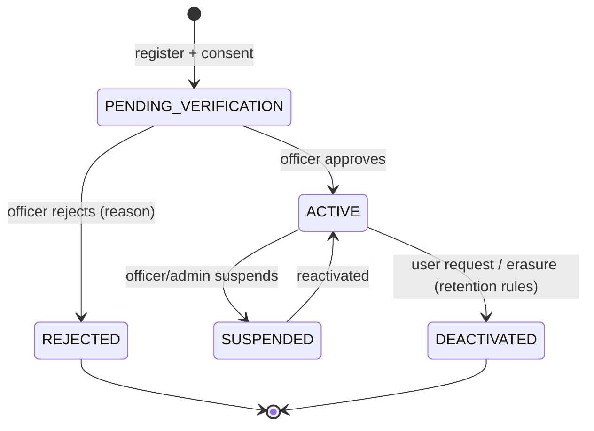

# Roles, Permissions and Access Design

## 1. Roles

| Role code | Interface | Who | Account creation | MFA |
|---|---|---|---|---|
| `OWNER` | `/owner` | Instrument owner | Self-register, officer approves | Optional |
| `TRADER` | `/owner` (+ bulk, services) | Manufacturer, dealer, repairer | Self-register, officer approves | Optional |
| `INSPECTOR` | `/inspector` | Field inspector | Invite only | Mandatory TOTP |
| `OFFICER` | `/officer` | Verification officer / supervisor | Invite only | Mandatory TOTP |
| `SENIOR_OFFICER` | `/officer` | Handles referred cases, dual approvals | Invite only | Mandatory TOTP |
| `ADMIN` | `/admin` | System / data admin | Invite only | Mandatory TOTP |
| (anonymous) | `/` | Public | none | none |

After login the BFF redirects by role. One person may hold more than one role only for Officer + Senior Officer; all other combinations are blocked.

## 2. Permission matrix

Enforced server-side (RBAC + jurisdiction scope + ownership scope + Row-Level Security). UI hiding is cosmetic only.
`own` = own business; `area` = assigned areas; `all` = everything; `reauth` = step-up authentication required.

| Capability | Public | Owner | Trader | Inspector | Officer | Sr Officer | Admin |
|---|---|---|---|---|---|---|---|
| Validate certificate, search directory, view rules | yes | yes | yes | yes | yes | yes | yes |
| Report tampering | yes | yes | yes | yes | - | - | - |
| Create instrument | - | own | own + on behalf | - | area (override duplicates) | area | all |
| Bulk register instruments | - | - | own | - | - | - | - |
| Edit instrument | - | own (locked fields after verification) | own | - | area | area | all |
| Transfer / de-register request | - | own | own | - | approve (area) | approve (area) | all |
| Apply for verification | - | own | own (batch) | - | on behalf | - | - |
| Upload application documents | - | own | own | - | on behalf | - | - |
| Document check | - | - | - | - | area | area | all |
| Schedule / reassign / reschedule | - | request | request | - | area | area | all |
| View assigned visit | - | - | - | assigned only | area | area | all |
| Enter inspection data | - | - | - | assigned only | - | - | - |
| Approve / reject | - | - | - | - | area, reauth | area, reauth | - |
| Refer to senior | - | - | - | - | area | - | - |
| Decide referred case, dual approval | - | - | - | - | - | area, reauth | - |
| Issue certificate | - | - | - | - | area (auto on approve) | area | - |
| Revoke / suspend | - | - | - | - | area, reauth, reason | area, reauth | all, reauth, reason |
| Re-issue certificate | - | - | - | - | area | area | - |
| Approve owner accounts | - | - | - | - | area | area | all |
| Invite staff, suspend users | - | - | - | - | - | - | all, reauth |
| Master data, rules (draft) | - | - | - | - | read | read | all |
| Publish rules | - | - | - | - | - | - | second admin, reauth |
| Enforcement drives, notice letters | - | - | - | - | area | area | all |
| Reports | - | own | own | own | area | area | all |
| Audit log | - | own | own | own | area | area | all (verify chain) |
| View PII of a user (break-glass) | - | - | - | - | - | - | reauth + reason, audited |
| Data-subject requests (raise) | - | own | own | own | own | own | own |
| Data-subject requests (handle) | - | - | - | - | - | - | all |

## 3. Scope rules

1. **Ownership scope:** owner and trader see only rows whose `business_id` is theirs. A trader acting on behalf of an owner needs a recorded `on_behalf_of` link.
2. **Jurisdiction scope:** officers and inspectors see only rows in `areas` assigned to them (including child areas). Out-of-jurisdiction inspector assignment is an explicit, audited exception.
3. **Assignment scope:** inspectors see a visit only while it is assigned to them. They see the owner name masked until Arrive is captured, and only the contact needed for the visit.
4. **Out of scope = 404, not 403.** The API never confirms that an object exists.
5. **Row-Level Security** is the second layer. Per transaction the API sets `app.user_id`, `app.role`, `app.area_ids`; policies in `db/schema.sql` filter on them.
6. **Client-supplied IDs are never trusted for scoping.** Scope comes from the session.
7. **Automated IDOR tests** try cross-business and cross-area access on every endpoint (Phase 6 gate, started in Phase 2).

## 4. Account lifecycle

- PENDING users can see only the "Account pending verification" status page.
- Staff accounts start as `INVITED` and become ACTIVE after password set + MFA enrolment (invite link single-use, 24 h, signed).

## 5. Authentication and session design

| Topic | Design |
|---|---|
| Identity provider | Keycloak realm `nirikshan`; clients `nirikshan-web` (confidential, used by BFF) and `nirikshan-api` (resource server); Authorization Code + PKCE; no implicit flow |
| BFF | Next.js route handlers exchange the code, keep tokens in an encrypted Redis session; browser gets only an opaque `__Host-` cookie (`HttpOnly; Secure; SameSite=Lax`) |
| CSRF | SameSite + Origin/Referer check + double-submit token on every state-changing request |
| Passwords | Keycloak only (Argon2id), breached-password check, lockout with exponential delay, no user enumeration |
| OTP | 6 digits from CSPRNG, stored hashed, 5 min expiry, 5 attempts, resend 30 s and 5 per hour, per-number and per-IP limits, never logged |
| MFA | TOTP mandatory for staff (WebAuthn optional later), recovery codes, forced enrolment on first login |
| Step-up | Decisions, revoke/suspend, rule publish, key operations, exports: re-auth (`max_age=0` or fresh TOTP) within 5 minutes |
| Session | Idle 15 min staff / 30 min owner, absolute 8 h, refresh-token rotation with reuse detection, active-session list with revoke, logout everywhere |
| Token to API | BFF attaches the access token; API validates signature, issuer, audience, expiry on each call |

## 6. Privacy view per role

| Role | Sees | Never sees |
|---|---|---|
| Public | masked holder, category, capacity, class, ward/zone, validity | phone, email, address, GPS, owner name, inspector, documents |
| Owner / Trader | own data; inspector name only | inspector personal details; other owners |
| Inspector | assigned visit; owner contact needed for visit; owner name after Arrive | unassigned visits; documents beyond visit need |
| Officer | cases in jurisdiction; document views are audited | other jurisdictions |
| Admin | master data, rules, users, audit; PII only via break-glass | PII without reason + step-up |
