# Process Flows

All diagrams are Mermaid; they render in GitHub, VS Code (Markdown Preview Mermaid), and most doc tools.

## 1. State machines

The brief's single state list is split into three lifecycles.

### 1.1 Application (case) status

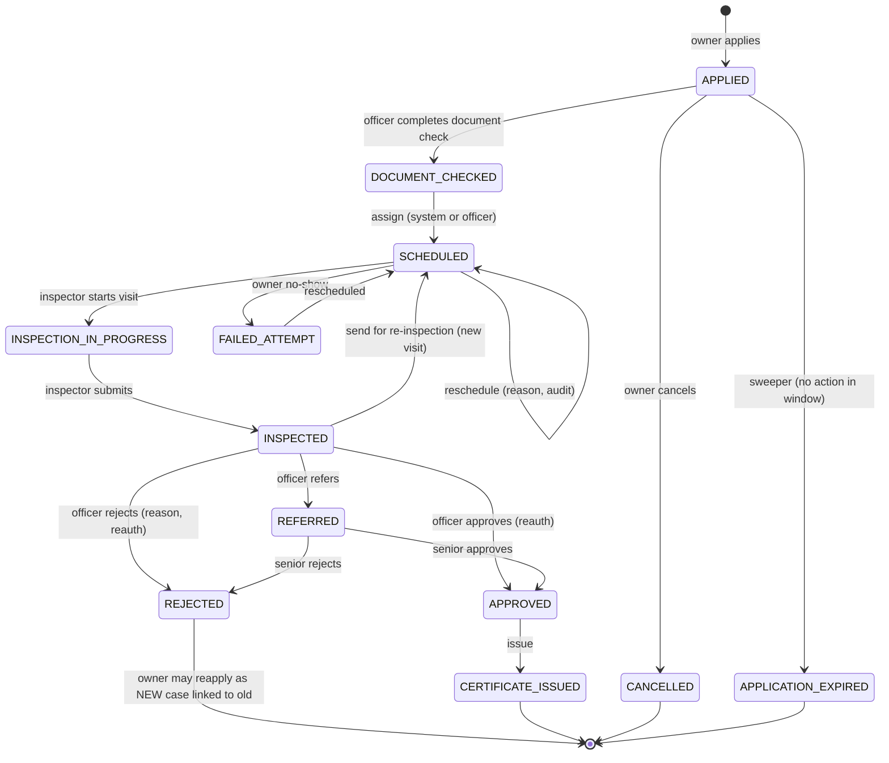

Terminal statuses (excluded from the "one open application per instrument" index): `REJECTED`, `CANCELLED`, `APPLICATION_EXPIRED`, `CERTIFICATE_ISSUED`.

Transition table (implemented in `packages/shared`, enforced in the `applications` service):

| From | Action | To | Roles | Guard | Side effects |
|---|---|---|---|---|---|
| APPLIED | documentCheckComplete | DOCUMENT_CHECKED | officer | all required documents accepted | notify owner, trigger scheduler |
| APPLIED | cancel | CANCELLED | owner | only while APPLIED | notify officer |
| DOCUMENT_CHECKED | assign | SCHEDULED | system, officer | inspector in jurisdiction, capacity, skill | store score breakdown, notify owner + inspector |
| SCHEDULED | reschedule | SCHEDULED | officer, system | min notice; reason | audit, notify |
| SCHEDULED | startVisit | INSPECTION_IN_PROGRESS | inspector | assigned, within window | create visit record |
| SCHEDULED | markNoShow | FAILED_ATTEMPT | officer, system | window passed, owner absent | release slot, notify |
| INSPECTION_IN_PROGRESS | submit | INSPECTED | inspector | evidence complete, server verdicts computed | generate test sheet PDF, notify officer |
| INSPECTED | approve | APPROVED | officer, senior | reauth; documents, data, MPE, evidence all OK | compute validity |
| INSPECTED | reject | REJECTED | officer, senior | reauth; reason code + remarks | notify owner with next steps |
| INSPECTED | refer | REFERRED | officer | senior exists in area | notify senior |
| INSPECTED | reinspect | SCHEDULED | officer | reason | new visit, original sheet kept |
| APPROVED | issue | CERTIFICATE_ISSUED | system, officer | none | number, PDF, fingerprint, public index (same transaction) |

Every transition writes `case_status_history` and `audit_events` in the same DB transaction. Illegal transitions return 409.

### 1.2 Instrument lifecycle

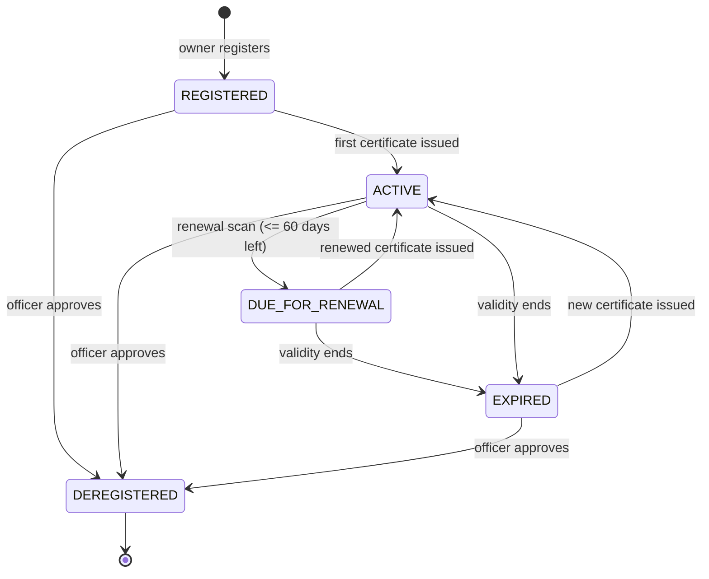

### 1.3 Certificate status

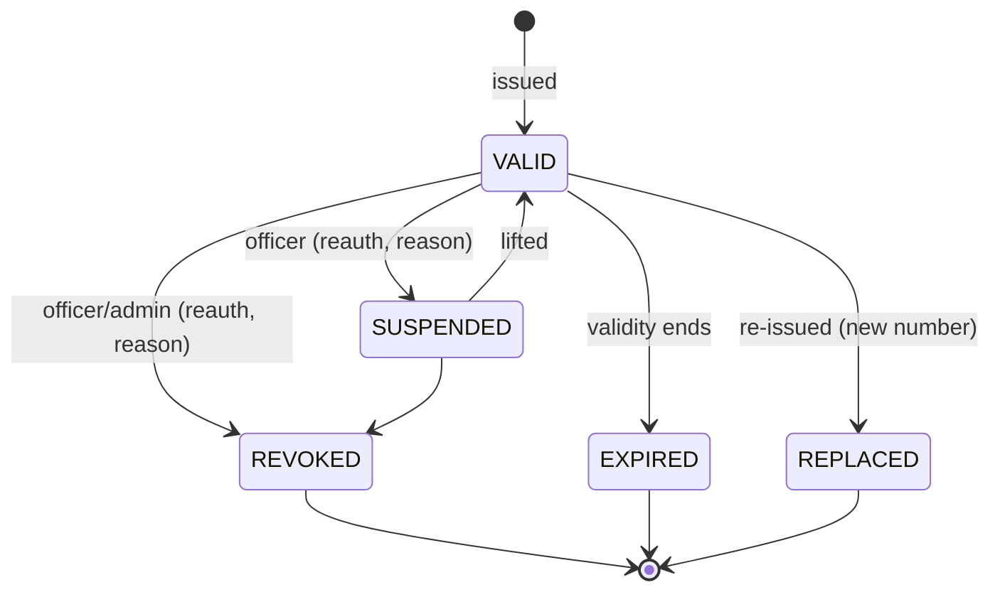

"EXPIRING" on the public page is a display state (VALID with 30 days or fewer left), not a stored status.

## 2. Registration and account approval

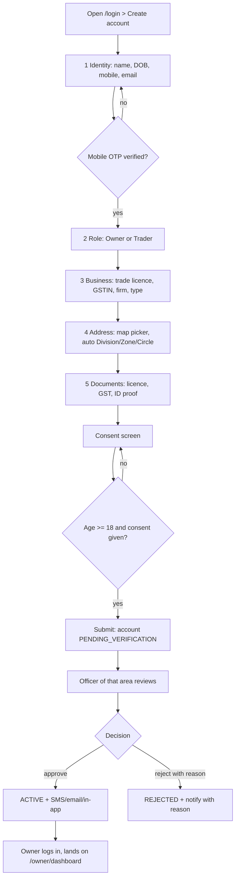

## 3. Instrument registration

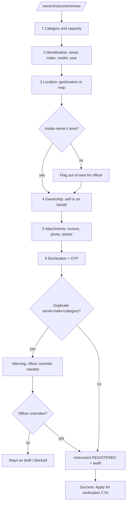

Draft autosaves to the server after each field; resumed from any device.

## 4. Application and document check

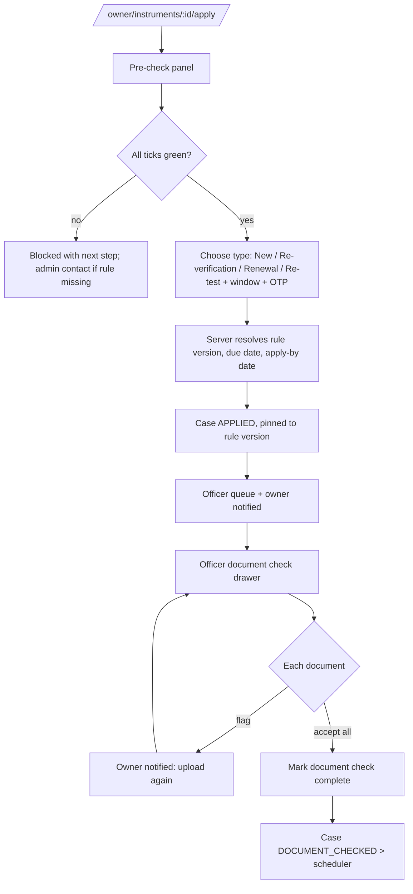

## 5. Scheduling

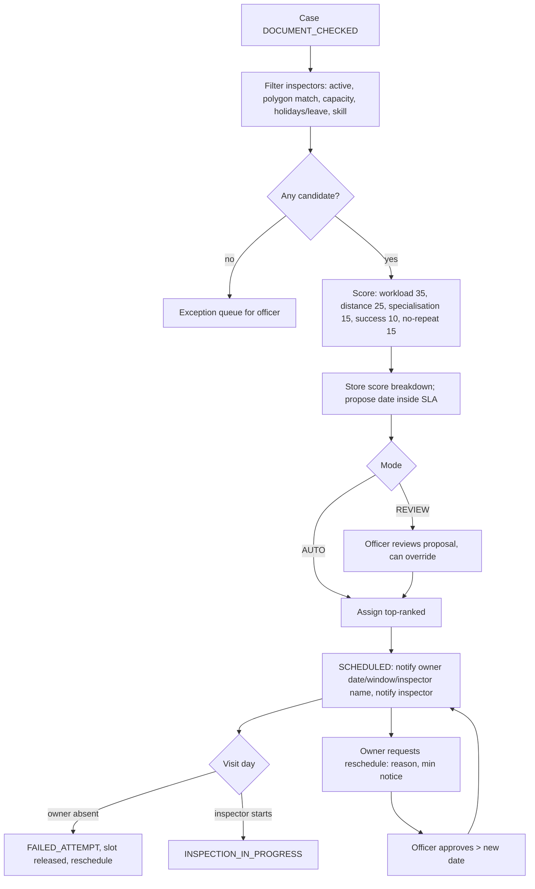

## 6. Inspection (mobile, online only)

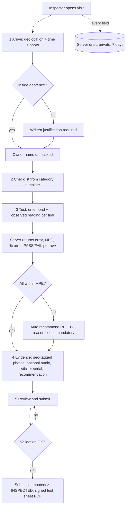

Connection lost: blocking banner; reopening restores the server draft.

## 7. Decision and certificate

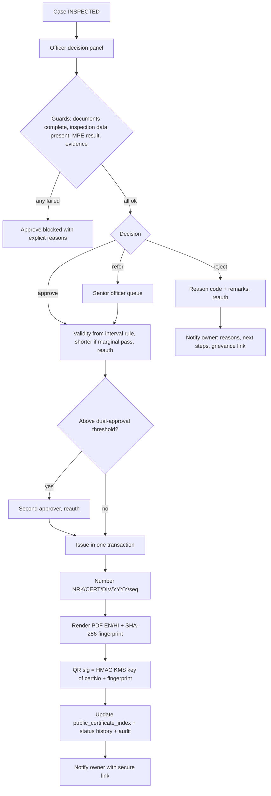

## 8. Public validation

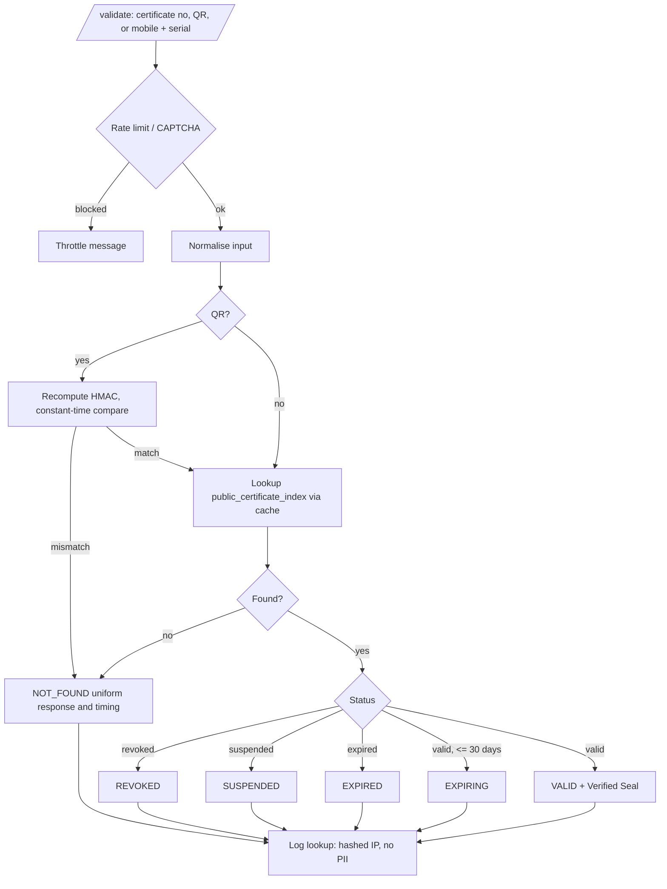

## 9. Renewal, expiry, enforcement, de-registration

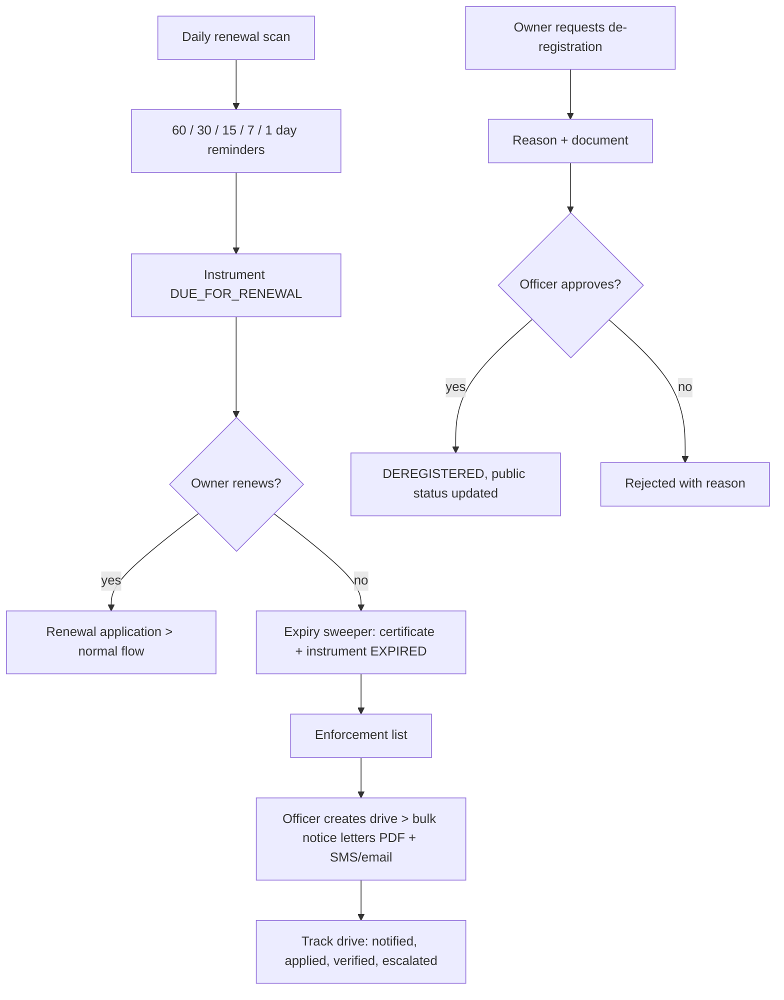

## 10. Notification matrix

| Event | Owner | Inspector | Officer | Channels |
|---|---|---|---|---|
| Account approved / rejected (reason) | yes | - | - | SMS + email + in-app |
| Application submitted | yes | - | queue | SMS + email + in-app |
| Documents flagged / document check complete | yes | - | - | email + in-app |
| Visit scheduled / rescheduled / cancelled | yes (date, window, inspector name) | yes | yes | SMS + email + in-app |
| Visit reminder (24 h before) | yes | yes | - | SMS + in-app |
| Owner no-show (FAILED_ATTEMPT) | yes | yes | yes | SMS + in-app |
| Inspection submitted | - | - | yes | in-app |
| Approved + certificate issued | yes (download link) | yes | - | SMS + email + in-app |
| Rejected (reasons, next steps, grievance link) | yes | yes | - | SMS + email + in-app |
| Renewal reminders 60/30/15/7/1 days | yes | - | - | SMS + email + in-app |
| Certificate expired | yes | - | enforcement list | email + in-app |
| Revoked / suspended | yes | - | - | SMS + email + in-app |
| SLA breach | - | - | yes | in-app + daily digest |
| Tamper report received | - | - | yes | in-app |
| Staff invite / MFA enrolment | staff | staff | staff | email |

Rules: EN/HI templates; per-user channel preferences (security notices cannot be disabled); no sensitive data in SMS/email bodies
(application no. + secure link only); every send in `message_log` with masked recipient; dedupe and quiet hours for non-critical SMS.
